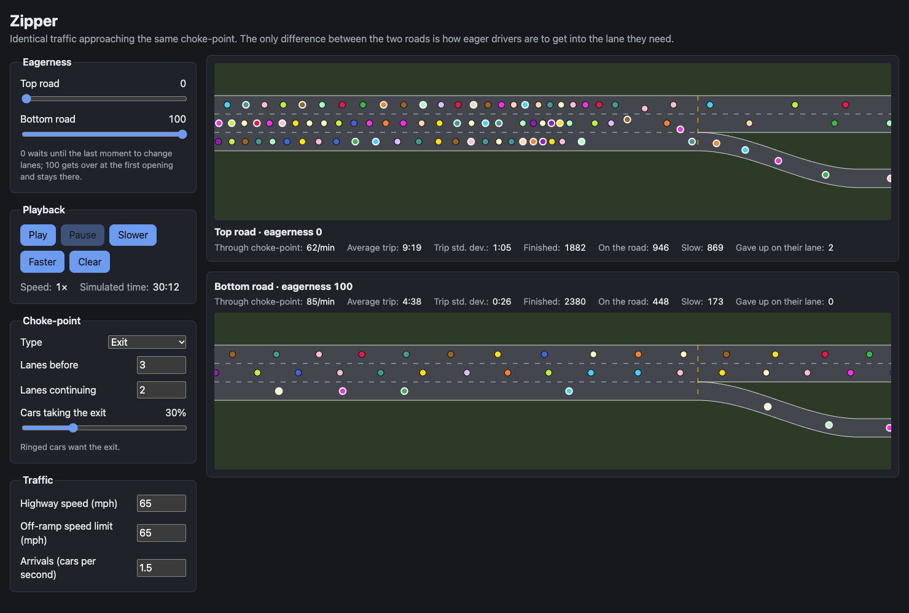

# Zipper

Zipper is a traffic simulation that compares two ways of handling a
choke-point: an exit, or a place where lanes end. Two roads run side by
side and get exactly the same cars, arriving at the same moments with the
same driving habits. The only difference between them is how eager drivers
are to get into the lane they need. Drivers on one road might wait until the
last moment and zipper-merge, while drivers on the other get over as soon as
they can. You can watch where the queues form and compare throughput and
trip times.

Each car is a colored dot. In exit scenarios, the cars with a white border
are the ones that want to take the exit. Everyone else wants to stay on the
highway, and has to get out of the exit lanes before the choke-point.

To run it, open `index.html` in a browser. There is nothing to build or
install.

What the controls do

### Eagerness

- **Top road / Bottom road**: how early drivers on that road commit to
  getting into the lane they need. At 0, a driver waits until there is just
  enough room left to make the lane changes, about 300 ft per lane. At 100,
  a driver starts trying as soon as they arrive, 1.5 miles before the
  choke-point, and stays in that lane once there. Each driver's
  eagerness varies a little around the value you set. Once drivers decide
  it's time to get over, they adjust their speed to line up with a gap and
  accept a slightly tighter gap than usual. The longer they go without
  managing it, the tighter the gap they'll accept.

### Playback

- **Play / Pause**: start and stop the simulation.
- **Slower / Faster**: change the playback speed, from 0.25× to 16×. At 1×,
  four simulated seconds pass for every real second.
- **Clear**: start over with fresh traffic, using the current settings.
- **Speed** and **Simulated time** show the current playback speed and how
  much simulated time has passed since the last restart.

### Choke-point

- **Type**:
  - **Exit**: the right-hand lanes become an off-ramp. Drivers taking the
    exit must be in those lanes by the choke-point, and everyone else must be
    out of them. A driver stuck waiting at the choke-point for too long gives
    up and takes the other road instead.
  - **Lane reduction**: lanes end on both sides, as evenly as possible
    (with the extra one on the right), and everyone must merge into the
    lanes that continue in the middle.
- **Lanes before**: how many lanes the road has before the choke-point.
- **Lanes continuing**: how many of those lanes carry on past it. With an
  exit, the remaining lanes form the off-ramp.
- **Cars taking the exit** (exit only): the share of drivers who want the
  exit.

Changing the type or the number of lanes restarts the simulation. The other controls take effect immediately.

### Traffic

- **Highway speed**: the speed drivers aim for before the choke-point. Each
  driver's target speed varies a little around it.
- **Off-ramp speed limit** (exit) or **Reduced-lanes speed limit** (lane
  reduction): the speed limit past the choke-point on the off-ramp, or on
  the lanes that remain. Drivers slow down gently to reach it by the
  choke-point.
- **Arrivals**: the average number of cars per second arriving at the start
  of the road, at random times. If the road is backed up past the start,
  new cars join the end of the queue.

### Statistics

Below each road:

- **Through choke-point**: cars passing the choke-point per minute, over the
  last minute.
- **Average trip** and **Trip std. dev.**: how long cars took from arriving to
  leaving the road, over the last five minutes.
- **Finished**: how many cars have left the road.
- **On the road**: how many cars are on the road right now.
- **Average speed** and **Speed std. dev.**: the average and standard
  deviation of the speeds of the cars that haven't reached the choke-point
  yet, including any queued up behind the arrival point.
- **Gave up on their lane** (exit only): how many drivers took the other road
  because they couldn't get into the lane they wanted.

## License

Zipper is released into the public domain. See [UNLICENSE.txt](UNLICENSE.txt).
